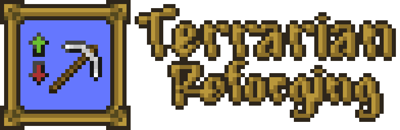
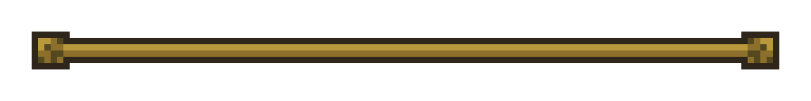

# 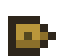 Random modifiers added on craft/looting/trading
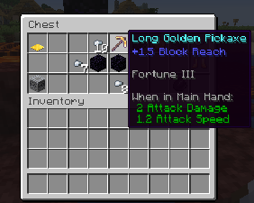 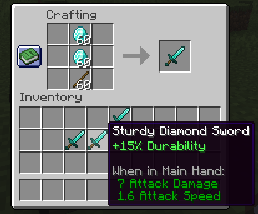 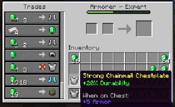
#  Reforging
### Token + Equipment + It's Anvil Material.
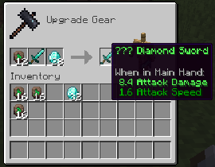

#  Sharpening
### Sharpening adds a temporary damage boost for X number of hits.
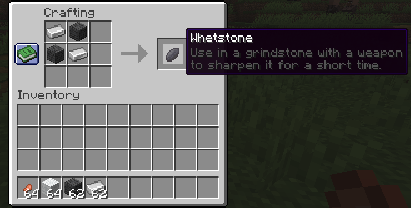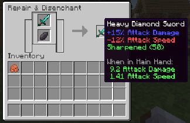

#  Scrubbing Modifiers Off
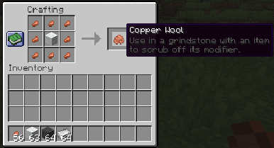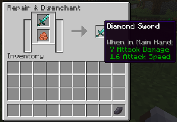

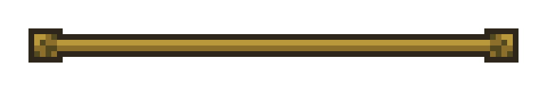