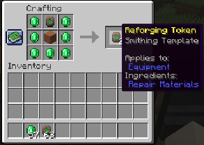

#  Random modifiers added on craft/looting/trading
  
#  Reforging
### Token + Equipment + It's Repair Material

#  Sharpening
### Sharpening adds a temporary damage boost for X number of hits.

#  Scrubbing Modifiers Off

